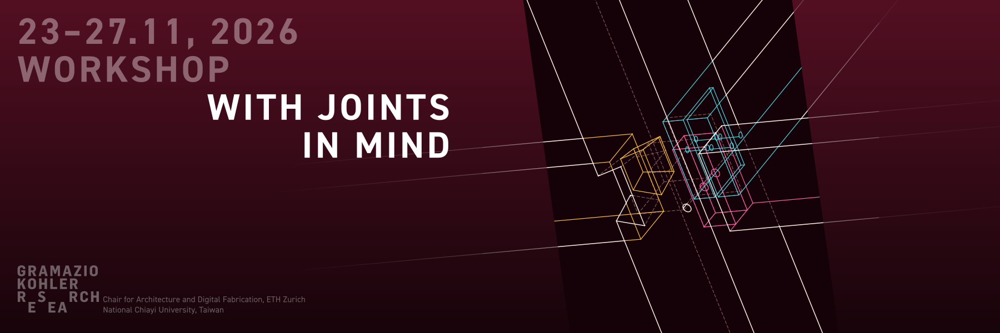

# With Joints in Mind

23–27.11.2026 · NCYU

Design a timber structure. Pick the place where three beams meet.
Write the joint for it in code. Mill it with a robot.

- `00_install.ghx`: open once in Rhino 8 to build the `wjim_ncyu2026` environment.
- [`joinery/`](joinery/README.md): the Grasshopper definition, toolpaths and the milling cell.
- [`wjim_lib/`](wjim_lib/README.md): the workshop's extension of `compas_timber`.
- `docs/`: the tutorial site (`uv run zensical serve`).
- `processing_lab/`: try a processing's toolpaths on a beam (`uv run processing_lab/server.py`).
- `exercises/`: the basic exercises, plain COMPAS and COMPAS Timber.

`uv sync` builds one `.venv` for the site and the processing lab (Rhino has its own, from `00_install.ghx`).
