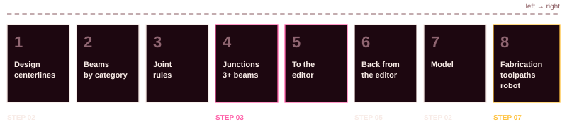

STEP 02 / 07

# Timber model

Open **`joinery/joinery.gh`**. Rhino units: **millimetres**.

## The canvas reads left to right

## 1 · Centerlines

A hyperbolic-paraboloid canopy from five sliders: `span_x`, `span_y`, `height_low`, `height_high`, `divisions`.
Drag them. Everything downstream follows.

## 2 · Beams, by category

| category | section (mm) | |
|---|---|---|
| `edge` | 80 × 160 | the four borders |
| `rafter` | 60 × 120 | one direction of the grid |
| `purlin` | 60 × 120 | the other direction |
| `post` | 100 × 100 | down to the ground |

The category is what the joint rules match on.

## 3 · Joint rules

The ordinary joints: where **two** beams meet (L, T, X), by category and by topology.
`rafter → edge`, `purlin → edge`, `crossings`.

## 7 · Model

Beams + rules → a `TimberModel` with all its cuts.

!!! note "Fresh Start"
    Keep it in front of **Model**. Without it, every re-run cuts each joint twice.

Two beams meeting is solved. **Three** is where it gets interesting → [Pick a junction](03-junction.md).
