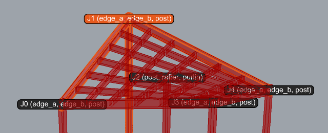
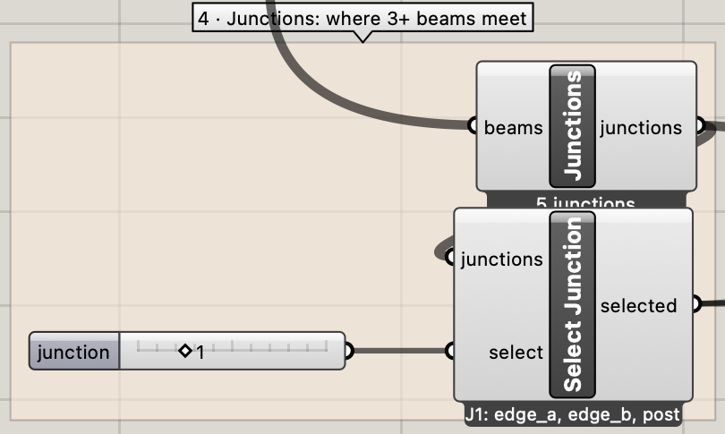
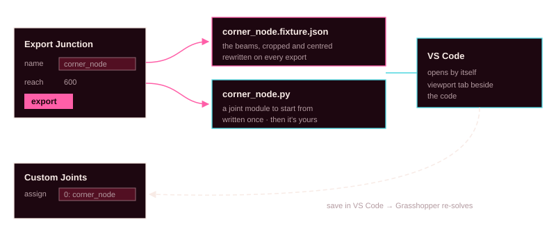
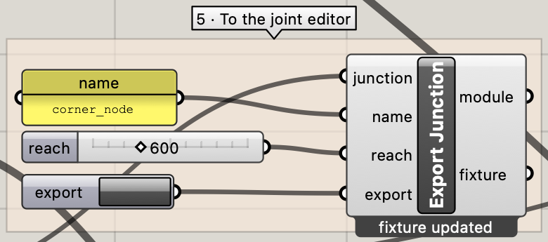

STEP 03 / 07

# Pick a junction

A **junction** is where three or more beams meet.
Group **4** finds them all and labels them in the viewport.

| | beams | topology |
|---|---|---|
| J0, J1, J3, J4 | `edge_a`, `edge_b`, `post` | Y · the four corners |
| J2 | `post`, `rafter`, `purlin` | K |

## 1 · Select

**Select Junction** → `junction` slider. The chosen one is highlighted, its beams outlined.

{ width="560" }

## 2 · Export

Group **5** · **Export Junction**:

1. `name` → a Python name, e.g. `corner_node`
2. `reach` → how much of each beam to take along (mm)
3. press **`export`**

{ width="560" }

!!! tip "Export again any time"
    The `.fixture.json` follows the design. Your `.py` is never overwritten.
