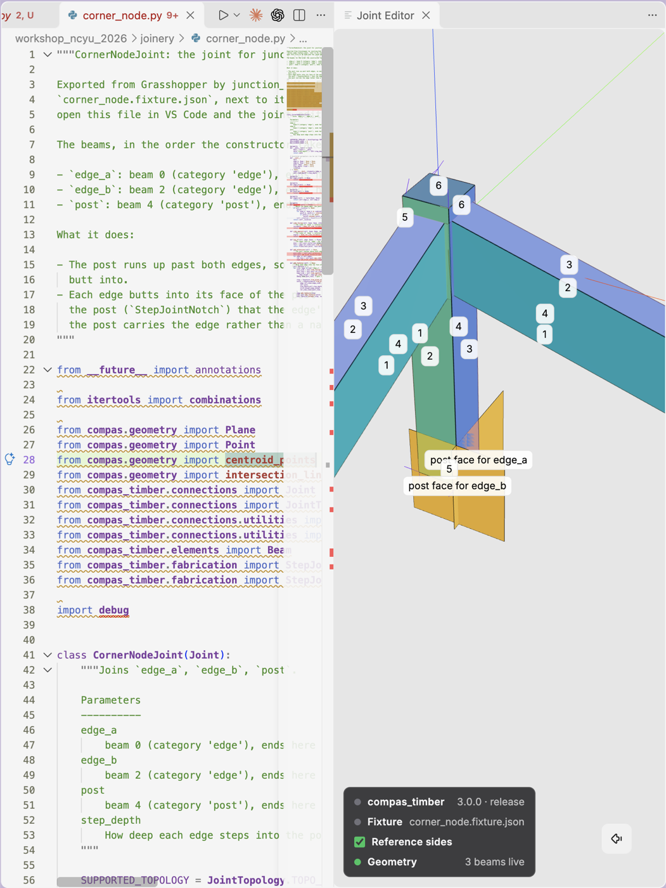
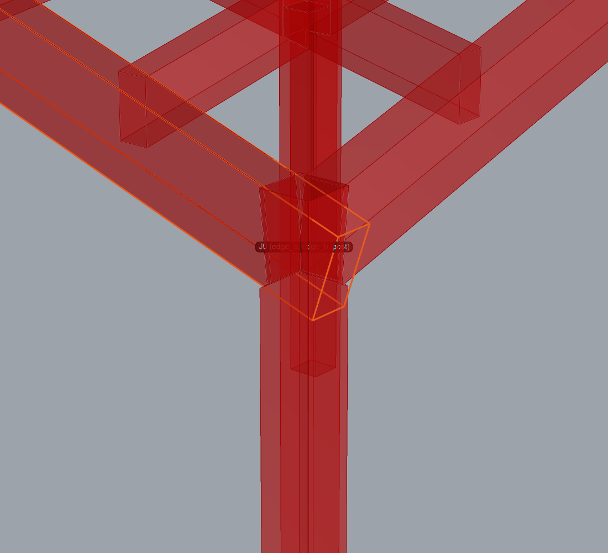

<p class="step">STEP 04 / 07</p>

# Write the joint

`corner_node.py` opens in VS Code. The **viewport** opens in a tab beside it,
running your code against the exported beams. Type, and it redraws.



## What runs

<div class="flow flow-down" aria-label="What runs: Fixture, __init__, add_extensions, add_features, BTLx processings">
  <div class="flow-box flow-pink"><b>Fixture</b><span>the beams, <code>role_bindings</code>, <code>params</code></span></div>
  <div class="flow-box flow-cyan"><b><code>__init__()</code></b><span><code>edge_a, edge_b, post</code>, <code class="flow-hi">step_depth=15.0</code></span></div>
  <div class="flow-box flow-cyan"><b><code>add_extensions()</code></b><span>lengthen blanks that must reach past the joint</span></div>
  <div class="flow-box flow-cyan"><b><code>add_features()</code></b><span>put processings on the beams</span></div>
  <div class="flow-box flow-yellow"><b>BTLx</b><span><code>StepJoint</code>, <code>StepJointNotch</code>, <code>Lap</code>, <code>Drilling</code> …</span></div>
</div>
<p class="flow-caption">one Run = Fixture in → geometry out · runs again as you type</p>

## The module you get

```python
class CornerNodeJoint(Joint):
    SUPPORTED_TOPOLOGY = JointTopology.TOPO_Y  # (1)!

    def __init__(self, edge_a=None, edge_b=None, post=None,
                 step_depth: float = 15.0, **kwargs):  # (2)!
        ...

    def add_extensions(self):  # (3)!
        ...

    def add_features(self):  # (4)!
        ...
```

1. Filled in from the junction you exported.
2. One argument per beam, named after its category. Annotated numbers are your parameters.
3. Make beams longer where they must reach past the joint.
4. **Your work.** Create BTLx [processings](b-processings.md) and add them to the beams.

!!! abstract "First: write it in words"
    The module's docstring asks you what the joint does, in carpentry terms.
    Which beam is cut? Which one carries? Do that before any code.

## Fill in `add_features`

The worked example, `joinery/corner_node.py`: each edge steps into its face of the post.

```python
def add_features(self):
    for edge in self.edges:
        post_face = self.side_facing(self.post, edge)  # (1)!
        edge_side = self.side_against(edge, post_face.normal)
        debug.show(post_face, "post face")  # (2)!

        step = StepJoint.from_plane_and_beam(post_face, edge, ...)
        notch = StepJointNotch.from_plane_and_beam(edge.ref_sides[edge_side], self.post, ...)
        edge.add_features(step)  # (3)!
        self.post.add_features(notch)
```

1. Which side of the post faces this edge? Asked, not typed.
2. Draws the frame in the viewport. Does nothing in Grasshopper.
3. The processing becomes a cut on the beam, and later a toolpath.

{ width="560" }

## Tools in the viewport

<div class="grid cards" markdown>

-   **Knob**

    ---
    Cursor on a number → a slider. Drag it, the number in your file changes.

-   **Probe**

    ---
    Cursor on a variable → its frame is drawn, or its value read out.

-   **`debug.show()`**

    ---
    Draw any geometry, with a label. Safe to leave in.

</div>
