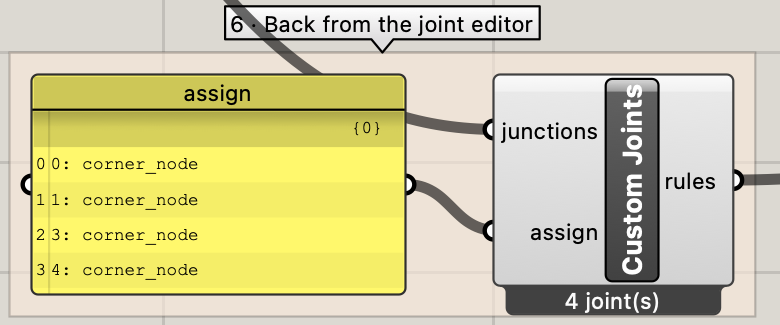
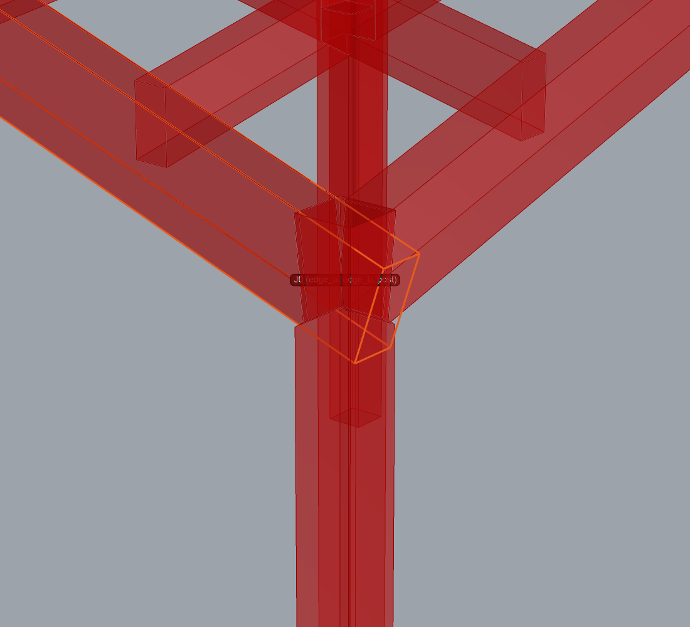

<p class="step">STEP 05 / 07</p>

# Back to Grasshopper

Group **6** · **Custom Joints** · the `assign` panel. One line per junction:

```text
0: corner_node
```

`<junction>: <module>`. That's it.

## Save = update

<div class="grid cards" markdown>

-   **VS Code**

    ---
    <kbd>Cmd</kbd>/<kbd>Ctrl</kbd>+<kbd>S</kbd> on `corner_node.py`

-   **Grasshopper**

    ---
    re-solves by itself, the joint shows up in the model

</div>

Custom joints win over every category and topology rule.
The message under **Custom Joints** says how many were applied.

{ width="560" }

{ width="560" }

??? failure "Nothing changes?"
    - A warning on **Custom Joints** names the line and the error.
    - `should define exactly one Joint subclass` → one class per file.
    - `joins 3 beams, but junction 2 has …` → wrong junction number.
    - A changed `junction_lib.py` / `toolpath_lib.py` → close and reopen `joinery.gh`.
