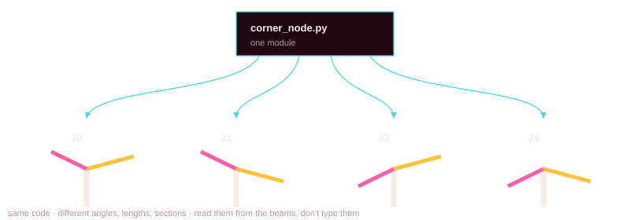

<p class="step">STEP 06 / 07 · OPTIONAL</p>

# Parameterize

Your joint works at one corner. Does it work at all four?

```text
0: corner_node
1: corner_node
3: corner_node
4: corner_node
```



That's the test: **one module, several junctions.** If one of them breaks, something was typed that should have been asked.

## Ask, don't type

=== "modelled"

    ```python
    post_side = 1           # true at J0 only
    depth = 15.0            # whatever the beam
    ```

=== "parametric"

    ```python
    post_side = self.side_facing(self.post, edge)
    _, height = edge.get_dimensions_relative_to_side(edge_side)
    ```

Utilities to ask with: `beam_ref_side_incidence`, `beam_ref_side_incidence_with_vector`,
`side_facing`, `get_beam_direction_towards_joint`, `extension_to_plane`.

## Parameters

An annotated number in `__init__` is a parameter. The **Fixture** sets it for the editor:

```json
"params": { "step_depth": 15.0 }
```

## A different situation?

Same idea, other values → copy the module under a new name and assign it where it belongs:

```text
0: corner_node
1: corner_node_deep
```
