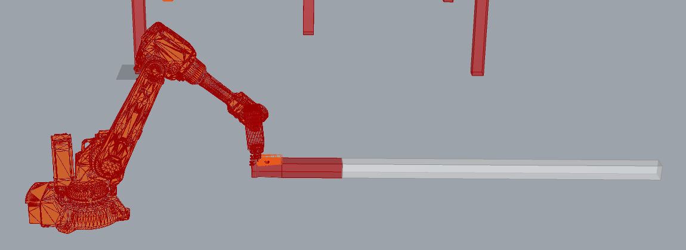

<p class="step">STEP 07 / 07</p>

# Toolpaths

Group **8** · one beam of the selected junction, clamped on the table, milled by the IRB2600.

<div class="flow" style="--cols: 5" aria-label="Toolpaths, in five steps: beam, side, compute, t, unreachable">
  <div class="flow-box"><span class="flow-n">1</span><b><code>beam</code></b><span>which beam of the junction</span></div>
  <div class="flow-box"><span class="flow-n">2</span><b><code>side</code></b><span>reference side facing up (0–3)</span></div>
  <div class="flow-box flow-yellow"><span class="flow-n">3</span><b class="rt-yellow"><code>compute</code></b><span>press it · nothing runs before</span></div>
  <div class="flow-box flow-yellow"><span class="flow-n">4</span><b><code>t</code></b><span>scrub 0 → 1, the robot follows</span></div>
  <div class="flow-box"><span class="flow-n">5</span><b><code>unreachable</code></b><span>empty? good. Not? change side</span></div>
</div>
<p class="flow-caption">6 mm bit · one side per setup · the beam stands where Calibration says</p>


| input | |
|---|---|
| `beam` | 0, 1, 2 … a beam of the junction |
| `side` | which reference side faces up · empty: the first setup |
| `stepdown` | depth per pass (mm) |
| `turn` | 0°, 90°, 180° or 270°: turns the tool about the bit · same cut, other arm pose |
| `compute` | **press it** · nothing heavy runs before |
| `t` | scrub the robot along the path |



## Read the list

The robot mills from above, so the beam is milled in **setups**: clamped one side up, milled, turned, clamped again.
`toolpaths` lists them, and what is left to the saw or to you:

```text
setup 1/2: side 0 up, 1300 frames  <- shown
    Tenon: tenon from side 0, 30 mm deep, 1300 frames
setup 2/2: side 2 up, 1300 frames
    Tenon: tenon from side 2, the beam flipped, 30 mm deep, 1300 frames
not milled:
    JackRafterCut: saw ...
```

Set `side` to the next setup's side to see it on the table, and run each setup as its own program.
Between setups, push the beam back into the corner of the L, at **A**.
With a `blank`, every setup mills the same blank, its cropped end against the stop and what's milled towards the other end.

## Before the real robot

!!! warning "Calibration"
    Measure **A** (origin), **B** (along the beam, the base's +y), **C** (away from the robot, the base's +x) on the table with the robot, type them into `calibration`.
    The L opens away from the robot: seen from behind it, A to B runs from right to left, A to C away from it. The beam lies inside the L, its corner at A, along A to B.
    On the table's surface, not on the beam: the beam's height is added for you.
    The angle shown should be close to 90°. [How it works](c-calibration.md)

!!! warning "Unreachable"
    `Robot` lists frames it can't reach. Fix them first: another `side`, another `turn`, or another beam position.
