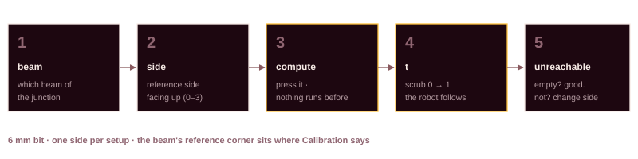
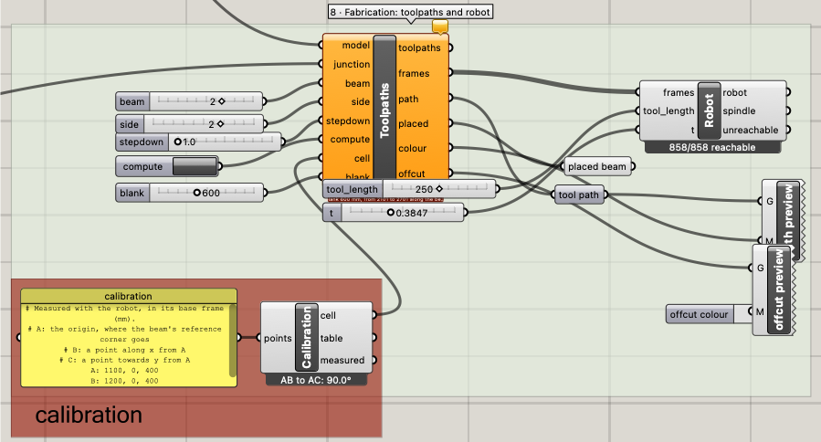

<p class="step">STEP 07 / 07</p>

# Toolpaths

Group **8** · one beam of the selected junction, clamped on the table, milled by the IRB2600.





| input | |
|---|---|
| `beam` | 0, 1, 2 … a beam of the junction |
| `side` | which reference side faces up |
| `stepdown` | depth per pass (mm) |
| `compute` | **press it** · nothing heavy runs before |
| `t` | scrub the robot along the path |


## Read the list

`toolpaths` says what happens to every processing of that beam:

```text
StepJointNotch: step notch, 858 frames
StepJointNotch: step notch, 832 frames needs another setup (side 1 up)
```

One side per setup. *needs another setup* → set `side` and compute again.

## Before the real robot

!!! warning "Calibration"
    Measure **A** (origin), **B** (along X), **C** (towards Y) on the table with the robot, type them into `calibration`.
    The angle shown should be close to 90°.

!!! warning "Unreachable"
    `Robot` lists frames it can't reach. Fix them first: another `side`, or another beam position.
