<p class="step">APPENDIX</p>

# Processings

Everything the robot can mill: the processings `toolpaths()` in `joinery/toolpath_lib.py` has a toolpath for.
Any other processing is valid, but listed as *no toolpath yet*.

Cyan is what the processing leaves, the dashed line the beam before it.
Every picture is a beam modelled by compas_timber, and its toolpath was computed too. Try them all in the [processing lab](a-processing-lab.md).

!!! note "6 mm bit"
    It only comes from above, square to the side that faces up.
    Inside corners stay round, and anything narrower than 6 mm isn't milled.

All lengths are in mm, all angles in degrees. Put one on a beam with `beam.add_features(processing)`.

## compas_timber

<div class="grid cards" markdown>

-   ### BirdsMouth

    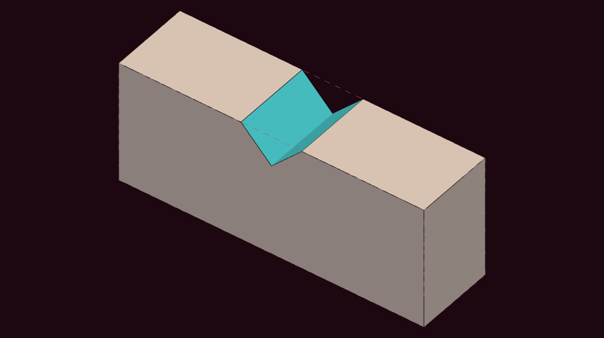

    V-shaped notch across the beam, to sit on an edge.

    *Sloped faces come out in steps of a layer.*

    ```python
    from compas_timber.fabrication import BirdsMouth
    ```

    [:octicons-arrow-right-24: API reference](https://gramaziokohler.github.io/compas_timber/3.0.2/api/compas_timber.fabrication/#compas_timber.fabrication.BirdsMouth)

-   ### DoubleCut

    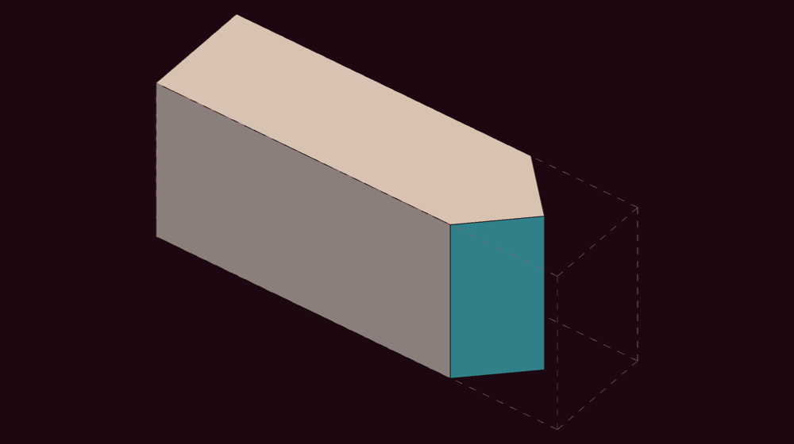

    Two planes cut the end to a point, or notch a V into it.

    ```python
    from compas_timber.fabrication import DoubleCut
    ```

    [:octicons-arrow-right-24: API reference](https://gramaziokohler.github.io/compas_timber/3.0.2/api/compas_timber.fabrication/#compas_timber.fabrication.DoubleCut)

-   ### Drilling

    

    Round hole, square or inclined, blind or through.

    *At least 6 mm in diameter.*

    ```python
    from compas_timber.fabrication import Drilling
    ```

    [:octicons-arrow-right-24: API reference](https://gramaziokohler.github.io/compas_timber/3.0.2/api/compas_timber.fabrication/#compas_timber.fabrication.Drilling)

-   ### FreeContour

    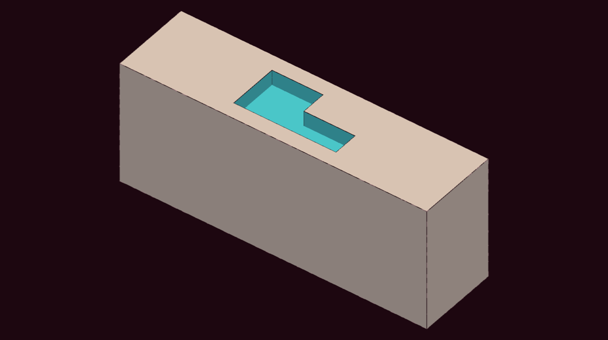

    Cut along any polyline on a side.

    *Only with square walls (`inclination` 0).*

    ```python
    from compas_timber.fabrication import FreeContour
    ```

    [:octicons-arrow-right-24: API reference](https://gramaziokohler.github.io/compas_timber/3.0.2/api/compas_timber.fabrication/#compas_timber.fabrication.FreeContour)

-   ### JackRafterCut

    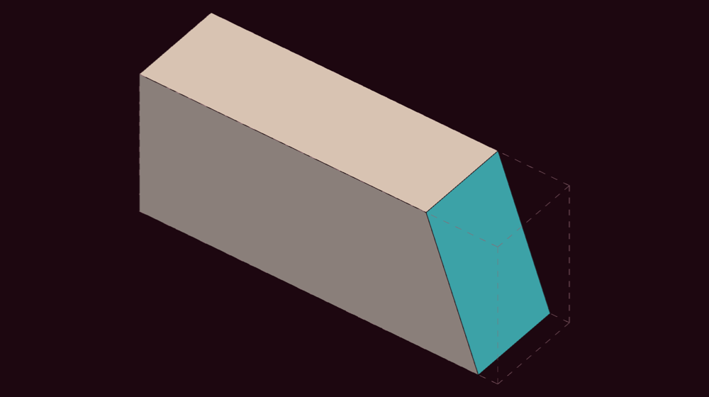

    One plane cuts off the end.

    ```python
    from compas_timber.fabrication import JackRafterCut
    ```

    [:octicons-arrow-right-24: API reference](https://gramaziokohler.github.io/compas_timber/3.0.2/api/compas_timber.fabrication/#compas_timber.fabrication.JackRafterCut)

-   ### Lap

    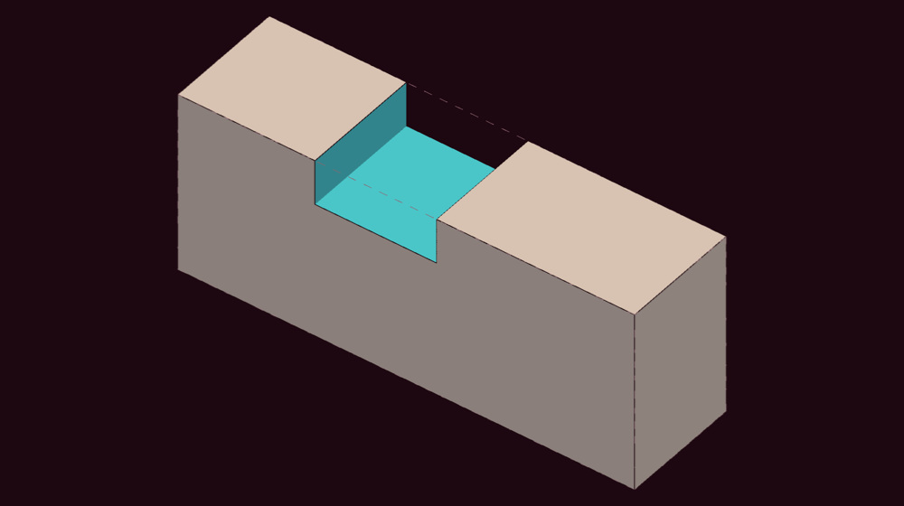

    Recess, usually through the width of the beam.

    *Square walls, at least 6 mm long.*

    ```python
    from compas_timber.fabrication import Lap
    ```

    [:octicons-arrow-right-24: API reference](https://gramaziokohler.github.io/compas_timber/3.0.2/api/compas_timber.fabrication/#compas_timber.fabrication.Lap)

-   ### LongitudinalCut

    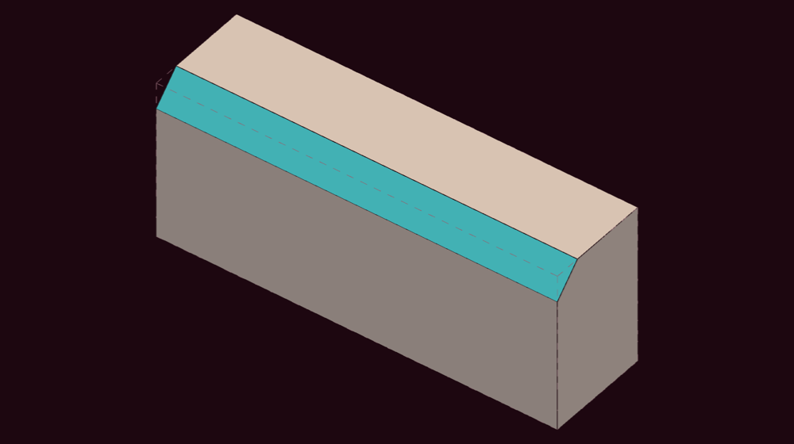

    Inclined cut along the beam.

    *Only the whole length: `start_limited`, `end_limited` and `depth_limited` aren't milled.*

    ```python
    from compas_timber.fabrication import LongitudinalCut
    ```

    [:octicons-arrow-right-24: API reference](https://gramaziokohler.github.io/compas_timber/3.0.2/api/compas_timber.fabrication/#compas_timber.fabrication.LongitudinalCut)

-   ### Mortise

    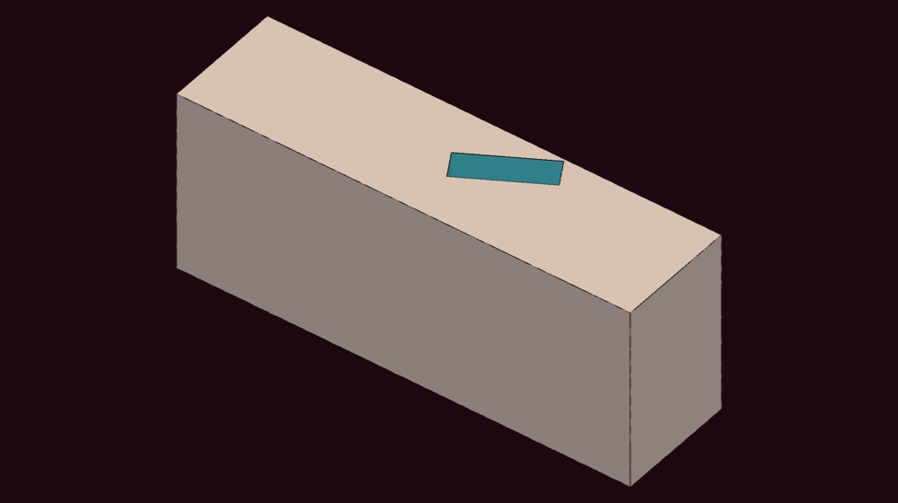

    Closed pocket for a tenon.

    *Set `shape="square"`. Corners come out at the bit's radius.*

    ```python
    from compas_timber.fabrication import Mortise
    ```

    [:octicons-arrow-right-24: API reference](https://gramaziokohler.github.io/compas_timber/3.0.2/api/compas_timber.fabrication/#compas_timber.fabrication.Mortise)

-   ### Pocket

    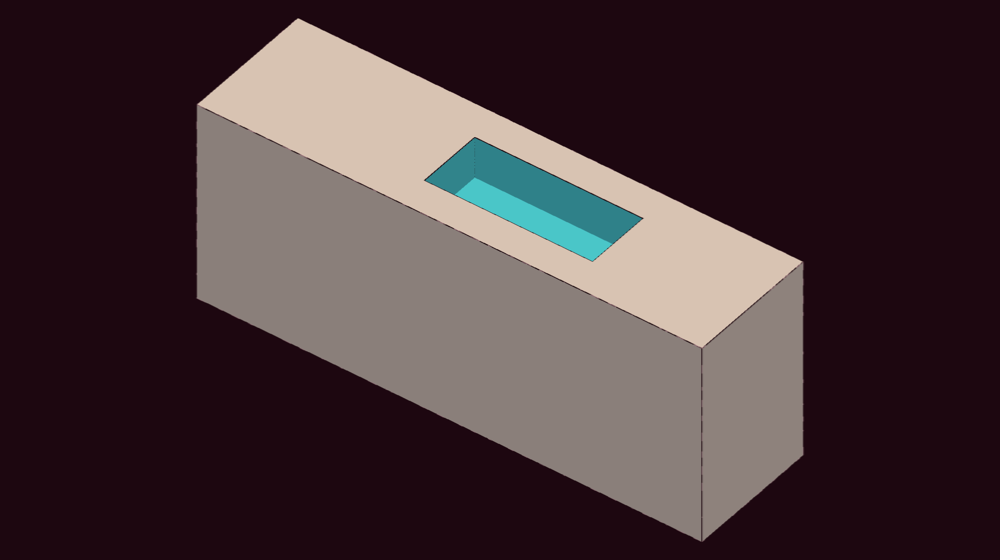

    Box-shaped pocket, its sides can be tilted.

    *A side that leans over the pocket is left standing.*

    ```python
    from compas_timber.fabrication import Pocket
    ```

    [:octicons-arrow-right-24: API reference](https://gramaziokohler.github.io/compas_timber/3.0.2/api/compas_timber.fabrication/#compas_timber.fabrication.Pocket)

-   ### Slot

    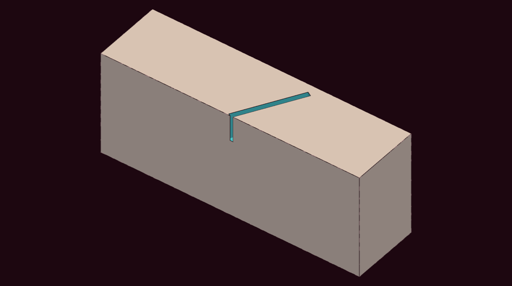

    Thin slot, for a blade or a plate.

    *At least 6 mm thick, open to the side it is on.*

    ```python
    from compas_timber.fabrication import Slot
    ```

    [:octicons-arrow-right-24: API reference](https://gramaziokohler.github.io/compas_timber/3.0.2/api/compas_timber.fabrication/#compas_timber.fabrication.Slot)

-   ### StepJoint

    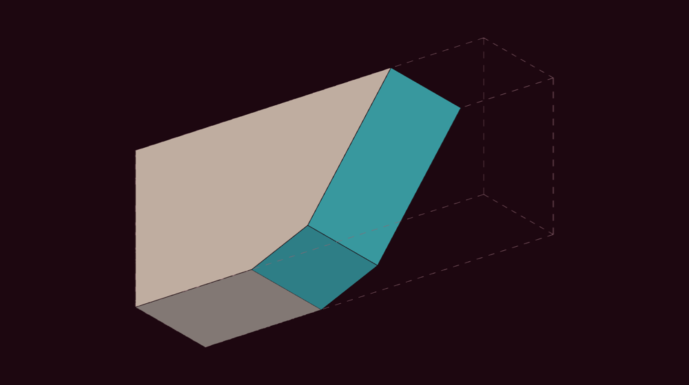

    Pointed end of a strut, for a step notch.

    *Without its `tenon`.*

    ```python
    from compas_timber.fabrication import StepJoint
    ```

    [:octicons-arrow-right-24: API reference](https://gramaziokohler.github.io/compas_timber/3.0.2/api/compas_timber.fabrication/#compas_timber.fabrication.StepJoint)

-   ### StepJointNotch

    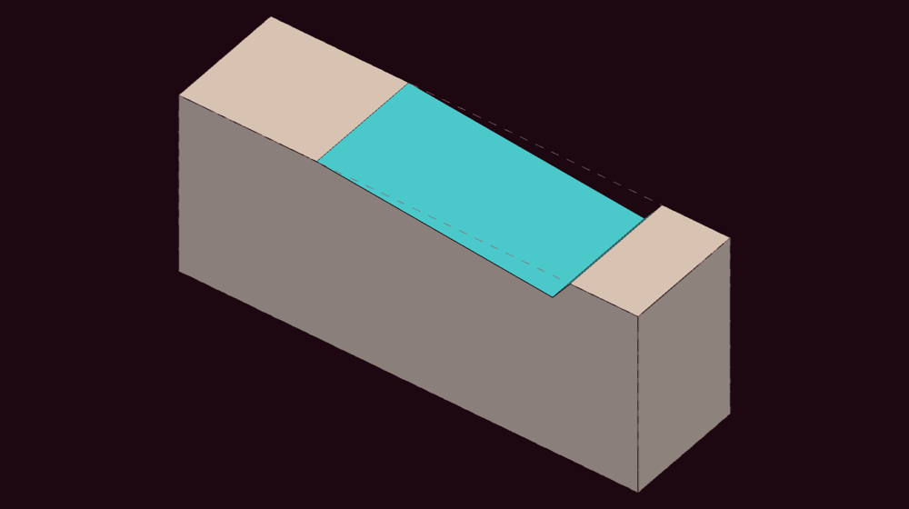

    Notch that seats a strut.

    *Only `step_shape="step"`.*

    ```python
    from compas_timber.fabrication import StepJointNotch
    ```

    [:octicons-arrow-right-24: API reference](https://gramaziokohler.github.io/compas_timber/3.0.2/api/compas_timber.fabrication/#compas_timber.fabrication.StepJointNotch)

-   ### Tenon

    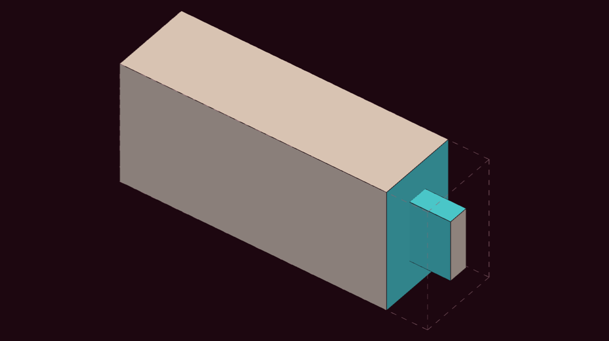

    Tenon on the end of the beam, for a mortise.

    *Set `shape="square"`; angles of 90°, no `chamfer`. Two setups.*

    ```python
    from compas_timber.fabrication import Tenon
    ```

    [:octicons-arrow-right-24: API reference](https://gramaziokohler.github.io/compas_timber/3.0.2/api/compas_timber.fabrication/#compas_timber.fabrication.Tenon)

-   ### Text

    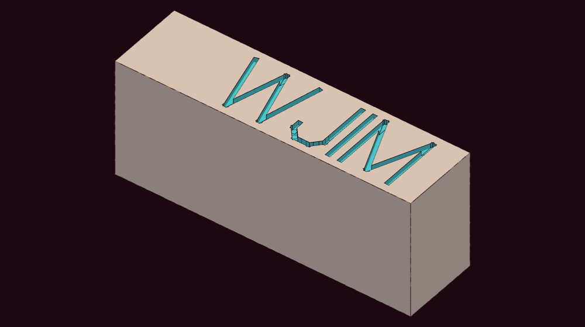

    Letters, engraved.

    *1 mm deep, 6 mm wide: use letters of 60 mm or more.*

    ```python
    from compas_timber.fabrication import Text
    ```

    [:octicons-arrow-right-24: API reference](https://gramaziokohler.github.io/compas_timber/3.0.2/api/compas_timber.fabrication/#compas_timber.fabrication.Text)

</div>

## Only in wjim_lib

Not in compas_timber 3.0.2: the parameters are here. All but `Chamfer` and `Planing` are placed on a reference side,
`ref_side_index` (0 to 3, default 0; reference side 1 is index 0).

### Chamfer

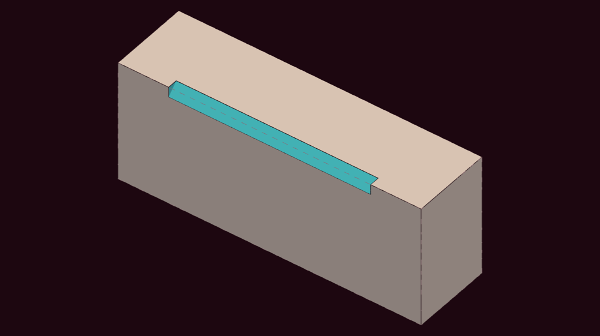{ width=560 }

Cuts the long edges of the beam at 45°.

*Limited ends only with `chamfer_exit="orthogonal"`. Only the edges of the side facing up: for the others, give the `Chamfer` another `ref_side_index`.*

```python
from wjim_lib import Chamfer
```

**From geometry**

No alternative constructor: give `Chamfer(...)` its parameters.

???+ info "Parameters of Chamfer"

    | parameter | default | |
    |---|---|---|
    | `start_x` | `0.0` | Distance from the start of the element to the start of the chamfer. Also the reference of `length` |
    | `start_limited` | `False` | If True the chamfer starts at `start_x`, otherwise it runs through the start of the element |
    | `end_limited` | `False` | If True the chamfer ends at `start_x` + `length`, otherwise it runs through the end of the element |
    | `length` | `0.0` | Length of the chamfer, including the exits |
    | `depth` | `1.0` | Size of the chamfer, measured along each of the two sides |
    | `chamfer_edge_12` | `True` | If True the edge between reference sides 1 and 2 is chamfered |
    | `chamfer_edge_23` | `True` | If True the edge between reference sides 2 and 3 is chamfered |
    | `chamfer_edge_34` | `True` | If True the edge between reference sides 3 and 4 is chamfered |
    | `chamfer_edge_41` | `True` | If True the edge between reference sides 4 and 1 is chamfered |
    | `chamfer_exit` | `"orthogonal"` | The shape of the limited ends of the chamfer: `"orthogonal"`, `"angular"`, `"round"` |

### HipValleyRafterNotch

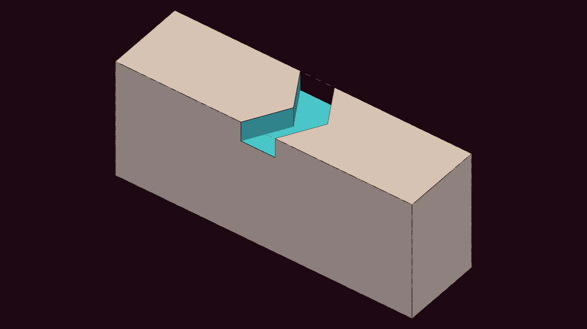{ width=560 }

Seats a hip or valley rafter on two counterparts: a chevron with a flat, sloped floor.

```python
from wjim_lib import HipValleyRafterNotch
```

**From geometry**

No alternative constructor: give `HipValleyRafterNotch(...)` its parameters.

???+ info "Parameters of HipValleyRafterNotch"

    | parameter | default | |
    |---|---|---|
    | `orientation` | `"start"` | `OrientationType.START` raises the floor towards the end of the part, `OrientationType.END` towards the start |
    | `start_x` | `0.0` | The x coordinate in the reference side of the chevron's tip, on the wall which faces away from the rising end of the floor |
    | `start_y` | `0.0` | The y coordinate in the reference side of the same tip |
    | `start_depth` | `20.0` | The depth of the same tip below the reference side |
    | `angle_ref_edge` | `45.0` | The angle in the floor between the arm towards the reference edge and the floor's direction falling away |
    | `angle_opp_edge` | `45.0` | The angle in the floor between the arm towards the opposite edge and the floor's direction falling away |
    | `inclination` | `30.0` | The angle between the floor and the reference side, along the part |
    | `width_counter_part_ref_edge_limited` | `False` | If True, the arm towards the reference edge stops at `width_counter_part_ref_edge`. Otherwise, it opens on the rising end of the floor |
    | `width_counter_part_ref_edge` | `120.0` | The width of the arm towards the reference edge, in the floor and perpendicular to the arm |
    | `width_counter_part_opp_edge_limited` | `False` | If True, the arm towards the opposite edge stops at `width_counter_part_opp_edge`. Otherwise, it opens on the rising end of the floor |
    | `width_counter_part_opp_edge` | `120.0` | The width of the arm towards the opposite edge, in the floor and perpendicular to the arm |
    | `rafter_nail_hole` | `False` | If True, a hole for the rafter nail is requested. It has no effect on the geometry |

### House

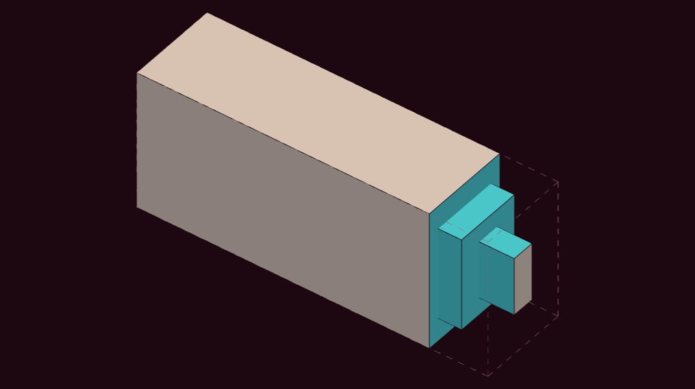{ width=560 }

A short, wide tenon. Another `Tenon` can stand on it.

*Set `shape="square"`; angles of 90°, no `chamfer`. Two setups, the beam flipped between them.*

```python
from wjim_lib import House
```

**From geometry**

```python
house = House.from_plane_and_beam(plane, beam, length=80, width=60, height=20, shape="square")
house.add_subprocessing(Tenon.from_plane_and_beam(tip_plane, beam, length=50, width=20, height=30, shape="square"))
```

`plane`: the shoulder, a `Plane` (or a `Frame`) whose normal points into the beam that stays. `tip_plane`: the same for the tenon, at the house's end face. `start_y` and `start_depth` move it off the middle. From `Tenon`: [`Tenon.from_plane_and_beam`](https://gramaziokohler.github.io/compas_timber/3.0.2/api/compas_timber.fabrication/#compas_timber.fabrication.Tenon.from_plane_and_beam).

???+ info "Parameters of House"

    | parameter | default | |
    |---|---|---|
    | `orientation` | `"start"` | which end: `"start"` or `"end"` |
    | `start_x` | `0.0` | distance along the reference edge to the shoulder |
    | `start_y` | `50.0` | distance from the reference edge to the middle of the house |
    | `start_depth` | `50.0` | distance below the reference side to the top of the house |
    | `angle` | `90.0` | between the shoulder and the reference edge. Milled: 90 |
    | `inclination` | `90.0` | between the shoulder and the reference side. Milled: 90 |
    | `rotation` | `90.0` | of the house on the shoulder. Milled: 90 |
    | `length_limited_top` | `True` | `False`: from the reference side. `from_plane_and_beam` sets `start_depth` to match |
    | `length_limited_bottom` | `True` | `False`: to the opposite side. `from_plane_and_beam` sets `length` to match |
    | `length` | `80.0` | size along the depth of the beam |
    | `width` | `40.0` | size across the reference side |
    | `height` | `28.0` | how far it stands out of the shoulder |
    | `shape` | `"automatic"` | of its edges: `"automatic"`, `"square"`, `"round"`, `"rounded"`, `"radius"`. Milled: `"square"` |
    | `shape_radius` | `20.0` | radius of those edges |
    | `chamfer` | `False` | chamfers its tip. Milled: `False` |
    | `subprocessings` | `None` | a list with the one `Tenon` on it. Its parameters refer to the beam |

### HouseMortise

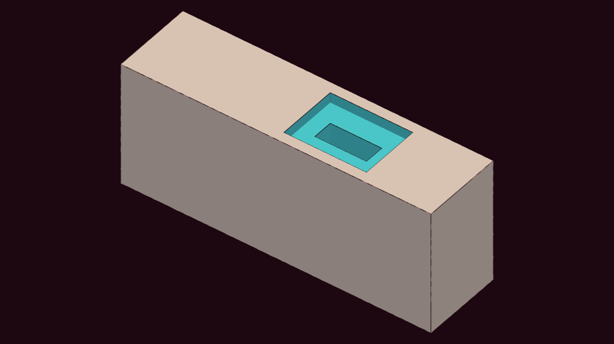{ width=560 }

A shallow, wide mortise. Another `Mortise` can go deeper from its floor.

*`shape` `"square"` or `"automatic"`, `slope` and `inclination` 90°. Corners come out at the bit's radius.*

```python
from wjim_lib import HouseMortise
```

**From geometry**

```python
house = HouseMortise.from_frame_and_beam(frame, beam, length=80, width=60, depth=10, shape="square")
house.add_subprocessing(Mortise.from_frame_and_beam(nested_frame, beam, start_depth=10, length=50, width=20, depth=30, shape="square"))
```

`frame`: on the reference side, its point in the middle of a short side of the mortise. `length` runs a quarter turn counterclockwise from its X axis, seen from outside. `nested_frame`: the same for the mortise inside. From `Mortise`: [`Mortise.from_frame_and_beam`](https://gramaziokohler.github.io/compas_timber/3.0.2/api/compas_timber.fabrication/#compas_timber.fabrication.Mortise.from_frame_and_beam).

???+ info "Parameters of HouseMortise"

    | parameter | default | |
    |---|---|---|
    | `start_x` | `0.0` | distance along the reference edge to the middle of one short side |
    | `start_y` | `50.0` | distance of that point from the reference edge |
    | `start_depth` | `0.0` | not used here: the pocket starts at the reference side |
    | `angle` | `0.0` | between its length and the reference edge |
    | `slope` | `90.0` | between its length and the reference side. Milled: 90 |
    | `inclination` | `90.0` | between its width and the reference side. Milled: 90 |
    | `length_limited_top` | `True` | written to BTLx |
    | `length_limited_bottom` | `True` | written to BTLx |
    | `length` | `80.0` | size along `angle` |
    | `width` | `40.0` | size square to `angle` |
    | `depth` | `28.0` | how deep it is |
    | `shape` | `"automatic"` | of its edges: `"automatic"`, `"square"`, `"round"`, `"rounded"`, `"radius"`. Milled: `"square"`, `"automatic"` |
    | `shape_radius` | `20.0` | radius of those edges |
    | `subprocessings` | `None` | a list with the one `Mortise` in it. Its parameters refer to the beam, its `start_depth` is the house's `depth` |

### LogHouseHalfLap

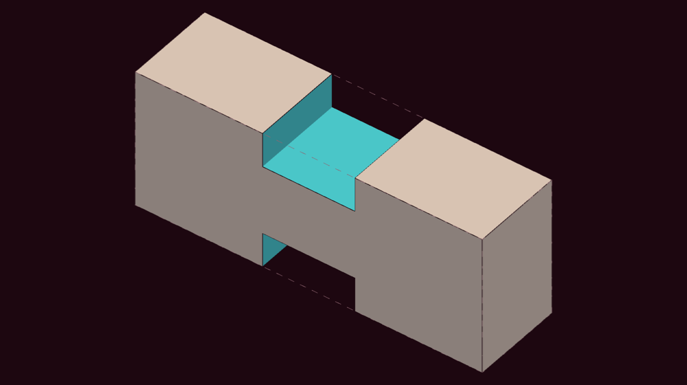{ width=560 }

Two notches across the beam, one from each side.

*Two setups, the beam flipped between them.*

```python
from wjim_lib import LogHouseHalfLap
```

**From geometry**

No alternative constructor: give `LogHouseHalfLap(...)` its parameters.

???+ info "Parameters of LogHouseHalfLap"

    | parameter | default | |
    |---|---|---|
    | `orientation` | `"start"` | `OrientationType.START` measures the angle from the part of the reference edge facing the start, `OrientationType.END` from the part facing the end |
    | `start_x` | `0.0` | The position along the reference edge of the middle of the notches |
    | `angle` | `90.0` | The angle in the reference side between the reference edge and the walls of the notches |
    | `length` | `120.0` | The distance between the walls of the notches, perpendicular to them |
    | `depth_ref_side` | `20.0` | The depth of the notch in the reference side |
    | `depth_opp_side` | `20.0` | The depth of the notch in the side opposite of the reference side |

### Marking

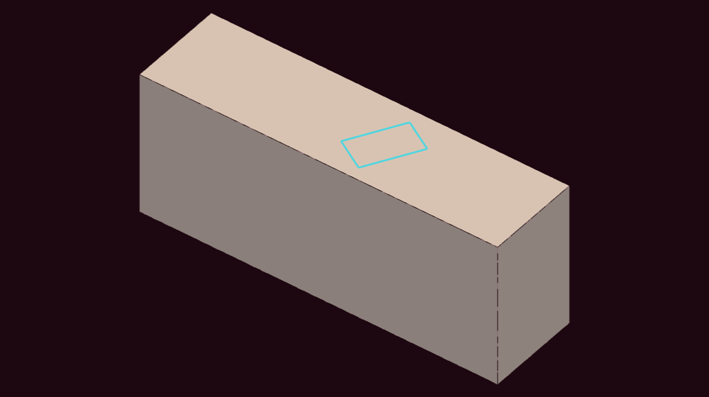{ width=560 }

Lines on a side: one, two parallel ones, or a parallelogram. Doesn't change the geometry: the picture shows the lines that are engraved.

*Engraved 1 mm deep and 6 mm wide. `"square"` needs `length_limited=True`.*

```python
from wjim_lib import Marking
```

**From geometry**

```python
Marking.from_line_and_element(line, element, ref_side_index=0, **kwargs)
```

`line`: a `Line`, projected onto the reference side. Gives a single line; pass `style` and `width` for the others. Also as `Marking.from_shapes_and_element(line, element, **kwargs)`.

???+ info "Parameters of Marking"

    | parameter | default | |
    |---|---|---|
    | `start_x` | `0.0` | Distance of the start point along the reference edge |
    | `start_y` | `0.0` | Distance of the start point from the reference edge |
    | `angle` | `0.0` | Angle, in degrees, from the direction towards the element's start (-X) to the first line, clockwise when looking at the side |
    | `length_limited` | `False` | If True the lines have the given `length`, otherwise they run across the whole side |
    | `length` | `20.0` | Length of the lines |
    | `width` | `100.0` | Distance from the start point to the start of the second line, for the styles `double` and `square` |
    | `interior_angle` | `90.0` | Angle, in degrees, clockwise from the first line to the direction of `width`, for the styles `double` and `square` |
    | `style` | `"single"` | The shape of the marking: `"single"`, `"double"`, `"square"` |

### MillContour

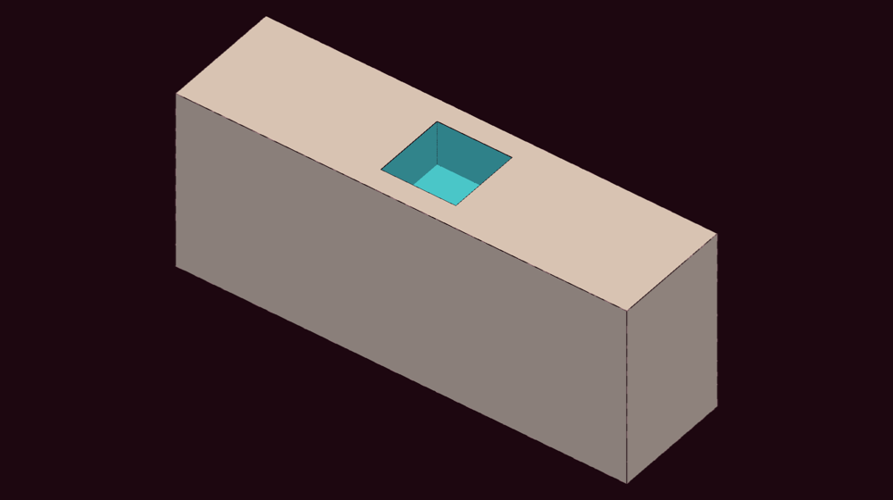{ width=560 }

`FreeContour`, for a milling tool.

*Only with square walls (`inclination` 0).*

```python
from wjim_lib import MillContour
```

**From geometry**

```python
MillContour.from_polyline_and_element(polyline, element, depth=None, interior=False, tool_position=None, ref_side_index=None, **kwargs)
MillContour.from_top_bottom_and_elements(top_polyline, bottom_polyline, element, interior=False, tool_position=None, ref_side_index=None, **kwargs)
MillContour.from_shapes_and_element(polyline, element, depth=None, interior=True, **kwargs)
```

`polyline`: a `Polyline` on one of the sides, in the coordinates of the model. No `depth`: the whole thickness. `interior`: the inside is removed. From `FreeContour`: [its API reference](https://gramaziokohler.github.io/compas_timber/3.0.2/api/compas_timber.fabrication/#compas_timber.fabrication.FreeContour).

???+ info "Parameters of MillContour"

    | parameter | default | |
    |---|---|---|
    | `contour_param_object` | *required* | a `Contour(polyline, depth, inclination)` from `compas_timber.fabrication`, the polyline in the coordinates of the reference side |
    | `tool_id` | `0` | which tool, written to BTLx |
    | `counter_sink` | `False` | `True`: a closed contour's inside is removed. `False`: the tool only follows the contour |
    | `tool_position` | `"left"` | side of the contour the tool is on, in its direction, seen from outside: `"left"`, `"center"`, `"right"` |
    | `depth_bounded` | `True` | `False`: cuts through |

### Planing

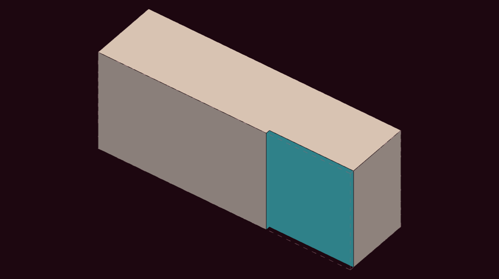{ width=560 }

Takes a layer off one or more of the long sides.

*One setup per planed side.*

```python
from wjim_lib import Planing
```

**From geometry**

No alternative constructor: give `Planing(...)` its parameters.

???+ info "Parameters of Planing"

    | parameter | default | |
    |---|---|---|
    | `start_x` | `0.0` | Distance from the start of the element to the start of the planing. Also the reference of `length` |
    | `length` | `0.0` | Length of the planing |
    | `depth` | `1.0` | Thickness of the removed layer |
    | `start_limited` | `False` | If True the planing starts at `start_x`, otherwise it runs through the start of the element |
    | `end_limited` | `False` | If True the planing ends at `start_x` + `length`, otherwise it runs through the end of the element |
    | `plane_side_1` | `True` | If True reference side 1 is planed |
    | `plane_side_2` | `True` | If True reference side 2 is planed |
    | `plane_side_3` | `True` | If True reference side 3 is planed |
    | `plane_side_4` | `True` | If True reference side 4 is planed |

### RidgeValleyCut

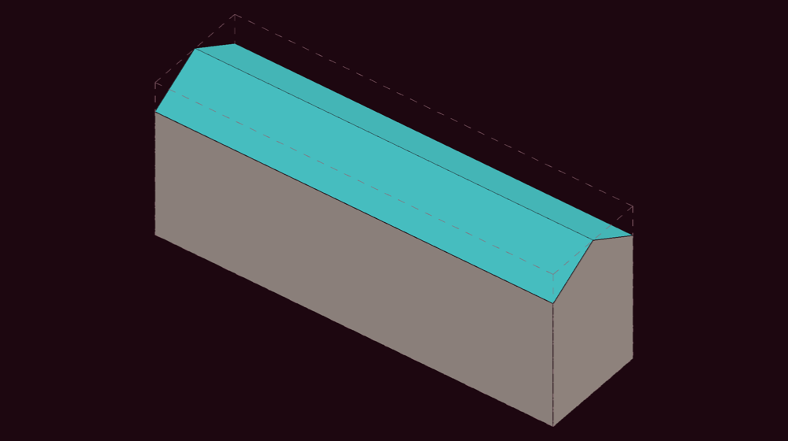{ width=560 }

Two inclined planes that meet in a line along the beam: a ridge, or with negative inclinations a valley.

```python
from wjim_lib import RidgeValleyCut
```

**From geometry**

No alternative constructor: give `RidgeValleyCut(...)` its parameters.

???+ info "Parameters of RidgeValleyCut"

    | parameter | default | |
    |---|---|---|
    | `start_x` | `0.0` | Distance along the reference edge from the start of the element to the start of the ridge line. Also the reference of `length` |
    | `start_y` | `50.0` | Distance from the reference edge to the ridge line |
    | `start_depth` | `0.0` | Distance of the ridge line below the reference side |
    | `inclination_ref_side` | `45.0` | Angle, in degrees, of the plane on the reference edge's side, from the plane parallel to the reference side through the ridge line |
    | `inclination_opp_side` | `45.0` | Angle, in degrees, of the plane on the opposite edge's side, from the plane parallel to the reference side through the ridge line |
    | `start_limited` | `False` | If True the cut stops at `start_x`, otherwise it runs through the start of the element |
    | `end_limited` | `False` | If True the cut stops at `start_x` + `length`, otherwise it runs through the end of the element |
    | `length` | `0.0` | Length of the ridge line |
    | `angle_ref_edge_start` | `90.0` | Angle, in degrees, inside the plane on the reference edge's side, between the ridge line and the line limiting the cut at its start |
    | `angle_ref_edge_end` | `90.0` | Same as `angle_ref_edge_start`, at the end of the cut |
    | `angle_opp_edge_start` | `90.0` | Angle, in degrees, inside the plane on the opposite edge's side, between the ridge line and the line limiting the cut at its start |
    | `angle_opp_edge_end` | `90.0` | Same as `angle_opp_edge_start`, at the end of the cut |

### TriangleCut

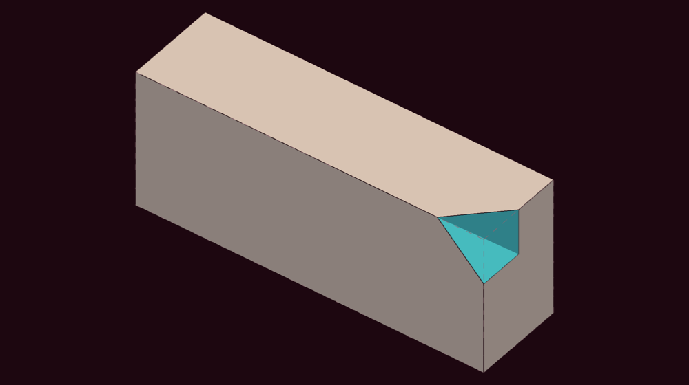{ width=560 }

Cuts out the wedge between two planes.

*Sloped faces come out in steps of a layer.*

```python
from wjim_lib import TriangleCut
```

**From geometry**

```python
TriangleCut.from_planes_and_element((plane_1, plane_2), element, ref_side_index=0, **kwargs)
```

The `Plane`s' normals point into the wedge that is removed. Not parallel. Also as `TriangleCut.from_shapes_and_element(plane_a, plane_b, element, **kwargs)`.

???+ info "Parameters of TriangleCut"

    | parameter | default | |
    |---|---|---|
    | `start_x` | `0.0` | Distance of the common point along the reference edge |
    | `start_y` | `60.0` | Distance of the common point from the reference edge |
    | `start_depth` | `60.0` | Distance of the common point below the reference side |
    | `normal_1_x` | `1.0` | X component of the normal of the first plane, in the coordinate system of the reference side, whose Z axis points out of the element |
    | `normal_1_y` | `0.0` | Y component of the normal of the first plane |
    | `normal_1_z` | `0.0` | Z component of the normal of the first plane |
    | `normal_2_x` | `1.0` | X component of the normal of the second plane, in the coordinate system of the reference side |
    | `normal_2_y` | `0.0` | Y component of the normal of the second plane |
    | `normal_2_z` | `0.0` | Z component of the normal of the second plane |
