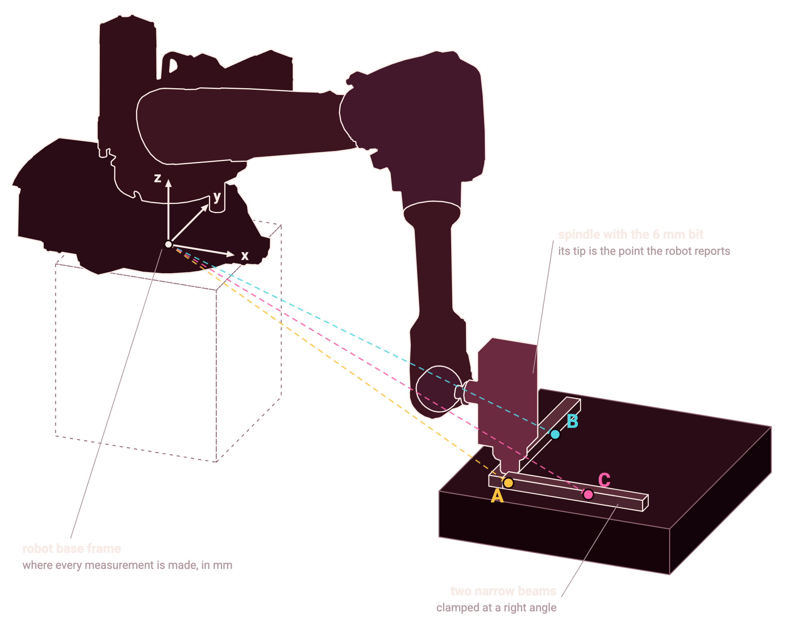
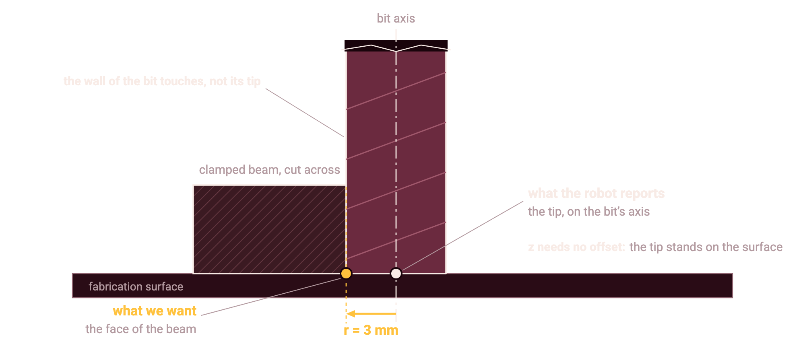
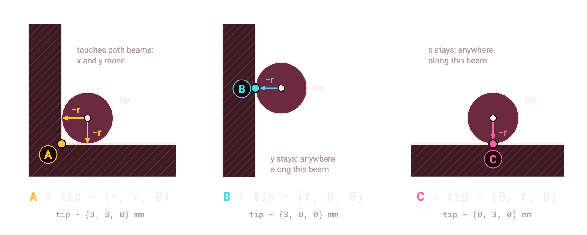
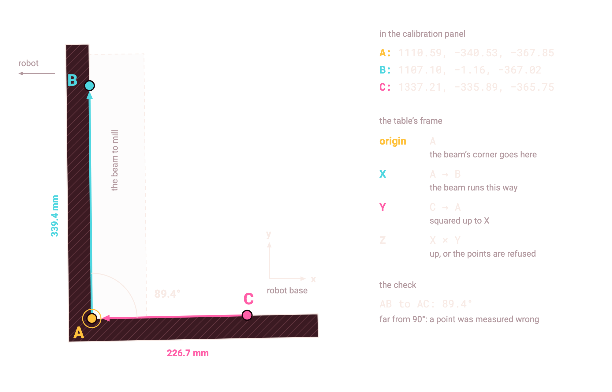

APPENDIX

# Calibration

The robot only knows its own base.
Three touches with the bit tell it where the fabrication surface is, and which way a beam lies on it.
What they give goes into `calibration`, in group **8** ([Toolpaths](07-toolpaths.md)).

## 1 · Touch three points

Two narrow beams are clamped to the surface at a right angle.
Where they meet is the origin, **A**. **B** is along one beam, **C** along the other.

<figure markdown>

<figcaption>The robot model with its tip at the measured A. The sizes of the clamped beams, the surface and the pedestal are illustrative.</figcaption>
</figure>

## 2 · The tip cannot reach the face

The bit has a thickness. When its wall is flush with the beam, its tip is still one radius away from the face.

<figure markdown>

<figcaption>Side view, bit enlarged.</figcaption>
</figure>

## 3 · Take off the radius

The offset goes only towards a beam the bit touches:
**A** sits in the corner and moves in x and y, **B** moves in x, **C** in y.

<figure markdown>

<figcaption>From above, bit enlarged. The robot base's x points right, away from the robot; y points up.</figcaption>
</figure>

## 4 · Three points make a frame

A beam pushed into the corner is now where the software expects it.

<figure markdown>

<figcaption>A, B and C to scale, from above, in mm in the robot's base frame. The beams are illustrative.</figcaption>
</figure>
