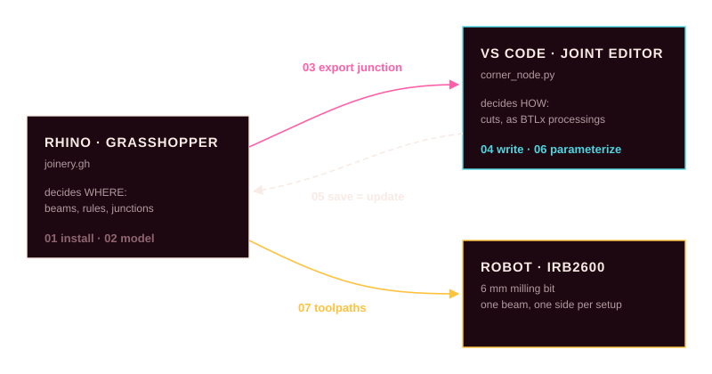

---
hide:
  - navigation
  - toc
---

23–27.11.2026 · NCYU

# With Joints in Mind

Design a timber structure. Pick the place where three beams meet.
Write the joint for it in code. Mill it with a robot.

## The round trip

## Seven steps

-   **01 · Install**

    ---
    One Grasshopper file sets up Rhino. One extension sets up VS Code.

    [:octicons-arrow-right-24: Install](01-install.md)

-   **02 · Timber model**

    ---
    Lines → beams → joint rules → model.

    [:octicons-arrow-right-24: Timber model](02-model.md)

-   **03 · Pick a junction**

    ---
    Where 3+ beams meet. Export it to the editor.

    [:octicons-arrow-right-24: Pick a junction](03-junction.md)

-   **04 · Write the joint**

    ---
    A Python class, live in a 3D viewport.

    [:octicons-arrow-right-24: Write the joint](04-joint-editor.md)

-   **05 · Back to Grasshopper**

    ---
    One line, and the joint is in the structure.

    [:octicons-arrow-right-24: Back to Grasshopper](05-back.md)

-   **06 · Parameterize** · *optional*

    ---
    One joint, many situations.

    [:octicons-arrow-right-24: Parameterize](06-parameterize.md)

-   **07 · Toolpaths**

    ---
    From the joint's cuts to the robot.

    [:octicons-arrow-right-24: Toolpaths](07-toolpaths.md)

